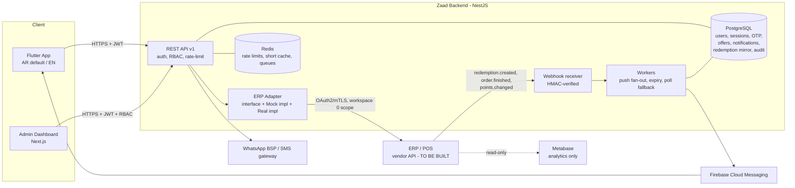

# Zaad Pharmacies App — ERP & Architecture Assessment (Decision Gate)

Date: 2026-11-08 · Status: **Gate NOT passed. Blockers listed in §4.**

## 0. What was actually inspected

| Source | Result |
|---|---|
| Attached repos (`test`, `test2`, `coursera-test`) | **Unrelated to Zaad.** `test` = a static landing-page clone, `coursera-test` = Jekyll README, `test2` = empty. No existing app code, no ERP client, no API docs. |
| ERP API documentation | **None provided or found.** No OpenAPI/Swagger, no Postman collection, no auth docs. |
| Metabase → DB `pos` (PostgreSQL, id 3) | Read-only SQL into the POS/ERP database. Multi-tenant: tables are sharded per workspace (`customer_0`, `customer_1`, …). **Workspace 0 = Zaad.** Everything below is from querying `*_0` tables. |

Workspace 0 numbers: **61 branches · 233,578 customers · 1.71M orders (since 2025-10-24) · ~21k point redemptions / 30 days.**

> Everything in this report is a **database-level** mapping, not an API mapping. The spec forbids marking a feature "supported" without a verified API. By that rule, **zero features are API-verified today.**

## 1. Metabase is not an integration path

Metabase is a BI tool. It cannot be the app's backend link to the ERP:
- read-only (no redemption decisions can be written back);
- row caps / query timeouts / no SLA, built for analysts not 233k app users;
- reading raw tables couples the app to an internal schema the vendor can change without notice;
- this Metabase login can run native SQL on a database that also holds other workspaces' tables (`_1`, `_2`, `_6`). Whatever the app uses must be scoped to workspace 0 only (PDPL).

Use Metabase only for what I used it for: discovery and validating business rules.

## 2. Data model found (workspace 0)

| Concept | Table | Key columns |
|---|---|---|
| Customer | `customer_0` | `id`, `name`, `phone_number`, `points` (int, current balance), `balance` (wallet), `identity_id`, `gender`, `age`, `deleted` |
| Invoice header (retail) | `orders_0` | `id`, `uuid`, `created_at`, `branch_id`, `customer_id`, `sub_total`, `discount`, `voucher_discount`, `tax_total`, `total`, `payment_method` (CASH/VISA/CASH_AND_VISA), `order_status` (FINISHED/PENDING/PROCESSING/CANCEL/REFUND/REFUND_PARTIALLY), `customer_use_point`, `point_used`, `point_to_cash`, `due_points_to_order` |
| Invoice lines | `order_detail_0` | `item_name`, `quantity`, `item_price`, `item_offer_discount`, `item_voucher_discount`, `item_points_discount`, `item_tax`, `item_price_after_discounts` |
| Refunds | `refund_order_operation_0` | `refunded_order`, `new_order`, `refund_value`, `operation_status` |
| Points log | `customer_timeline_0` | `operation` (ORDER_UPDATE_POINTS, ORDER_REFUND_POINTS, EDIT_POINTS, ORDER_UPDATE_WALLET, ORDER_REFUND_WALLET), `log` = **free-text Markdown** |
| Branch | `branch_0` | `name`, `city`, `province`, `latitude`, `longitude` |
| E-invoice | `zatca_invoices_0` | `order_id`, `document_type` (INVOICE/CREDIT_NOTE), `uuid`, `icv`, `status` |
| Unknown purpose | `user_token`, `workspace_integration_0`, `integration_profile` | Need vendor explanation (could be an existing API surface). |

## 3. Feature → ERP mapping

| App feature | DB source | API | Status |
|---|---|---|---|
| Customer lookup by mobile | `customer_0.phone_number` | none known | Data exists · **API missing** · normalization issues (§4 G4) |
| Customer profile | `customer_0` | none known | Data exists · **API missing** · names are cashier-typed (§4 G4) |
| Points balance | `customer_0.points` | none known | Data exists · **API missing** |
| Points history | `customer_timeline_0` (text) | none known | **Partial: unstructured, starts 2026-08-14** (§4 G2) |
| Invoice list | `orders_0` + `branch_0` | none known | Data exists · **API missing** · status filter undefined (§4 G6) |
| Invoice details | `order_detail_0` | none known | Data exists · **API missing** |
| Points earned per invoice | `orders_0.due_points_to_order` | none known | Data exists |
| Payment method | `orders_0.payment_method` | none known | Data exists |
| Branch info | `branch_0` | none known | Data exists |
| Redemption request (pending) | **does not exist** | — | **Missing entirely** (§4 G1) |
| Redemption approve/reject | **does not exist** | — | **Missing entirely** |
| Redemption status | `orders_0.point_used` (after the fact only) | — | **Missing** as a lifecycle |
| Webhooks / events | no outbox/event/webhook tables | — | **Missing** |
| API auth for 3rd-party backend | unknown | — | **Unknown** |

## 4. Gaps and problems (ranked)

### G1 — BLOCKER: the redemption approval flow does not exist in the ERP
Today redemption is **synchronous at the POS**: the cashier applies points, the order is saved with `point_used`/`point_to_cash`, and the balance changes at once (timeline: *"Customer redeemed [400] points and earned [58] points…"*). There is no pending state, no request ID, no expiry, no approve/reject.

The core MVP feature (spec §10) needs **ERP vendor work**:
1. a `redemption_request` entity: id, customer, branch, points, SAR value, status (PENDING/APPROVED/REJECTED/EXPIRED/COMPLETED/FAILED), expires_at, idempotency key;
2. a POS change so checkout **waits** on the request (or polls it) before the points discount is applied;
3. the ERP re-checks the live balance when it finalizes;
4. API endpoints for create/read/decide plus a webhook (or a pollable endpoint) for new requests.

**Business questions the spec skips — they must be answered before the vendor designs this:**
- About 700 redemptions a day across 61 branches. **What happens when the customer has no app, no data, a dead phone, or push is late?** Do they lose redemption, or can the cashier fall back (e.g. SMS OTP)? With no fallback, the feature makes redeeming *harder* than today, and the queue at the counter waits on it.
- Is in-app approval required for every redemption, or only above a threshold?
- Expiry length (60s? 3 min?) and what the POS shows while it waits.

### G2 — No structured points ledger
- `customer_timeline_0.log` is Markdown prose. Earn/redeem/refund amounts are inside the text, not in columns.
- It starts **2026-08-14**, but orders start 2025-10-24. **About 10 months of points history are not in it.**
- Every entry contains the **cashier's full name** ("Executed by: …"). That must not reach customers.
- Parsing this text in our backend would be brittle and would amount to rebuilding ERP logic, which the spec forbids.

**Required ERP change:** a structured ledger API (`type`, `points_delta`, `balance_after`, `order_id`, `branch_id`, `created_at`, `reason`).
**MVP fallback, only if you approve it:** history from `orders_0` columns (`point_used`, `due_points_to_order`) plus refund operations. That is read-only display of ERP fields, not calculation, but it **misses manual EDIT_POINTS adjustments**, so the screen would be incomplete. Your call.

### G3 — No API, no auth model, no events
No documented API exists for an external backend. We need from the vendor: base URL, auth (OAuth2 client-credentials or mTLS, scoped to workspace 0 only), rate limits, pagination, error format, versioning, and a webhook or event mechanism.
`user_token` / `workspace_integration_0` may be an existing integration surface. **The vendor must confirm.** I won't guess.

### G4 — Customer identity data quality (affects registration directly)
- Phone formats are mixed (`+966…` 12 digits is 99%; there are also 13–20 digit values and some without `+`).
- **61 groups of different customer records share the same last 9 digits.** The spec's "stop and require admin resolution" path will be hit. Admin tooling for it is not optional.
- **1,642** numbers don't look like Saudi mobiles. Those customers can't receive an OTP.
- Names are cashier free text (real examples of the pattern: "name + random digits", "… delivery 9999"). "Hello, samy 3232323" on the home screen is a real risk. Decide: show the ERP name as-is, use a neutral greeting, or clean the data.
- `identity_id` (likely national ID / Iqama) is present. Don't display it, and don't store it in our DB (PDPL).

### G5 — Data anomaly: one account holds 60.5% of all points
Customer `325439` has **128,339,979 points** (60.5% of the workspace total) across 23,607 orders. It is clearly an institutional/insurance or house account, not a person. Consequences:
- it must be **blocked from app registration**;
- any "total points liability" KPI in the admin dashboard is wrong unless such accounts are excluded;
- the 2nd-largest balance (532,974 points, 11 orders) also needs a look.

### G6 — Invoice semantics undefined
- Which number is the customer-facing invoice number: `orders_0.id`, `uuid`, or ZATCA `icv`? It must match the printed receipt.
- **58,637 orders are PENDING.** Which statuses appear in the app? Proposal: FINISHED, REFUND, REFUND_PARTIALLY, with refunds shown as linked credit notes. Needs approval.

## 5. Business rules: spec vs. data

| Spec rule | What the data shows | Verdict |
|---|---|---|
| 50 points = 1 SAR | `point_used / point_to_cash` = exactly 50 | ✅ Confirmed |
| Redeem "any amount", no minimum | `point_to_cash` is an **integer**, and redemptions are seen in 50-point steps (400, 500, 550, 1400) | ⚠️ "Any amount" is false. Actual granularity is 1 SAR = 50 points. The app copy must say this. |
| 1 point per 1 SAR | Median ≈ 1.0 per SAR of `total`, but samples show earning on the **amount before the points discount** (paid 49.60 + 8 SAR in points → 58 earned). One sample doesn't fit either reading. | ⚠️ The rule is more complex than the spec states. **The app must never compute earned points. Display `due_points_to_order` only.** Ask the vendor for the exact formula so the explainer text is honest. |
| Refunds handled by ERP | Refund logs: *"Restored [150] redeemed points and deducted [76] earned points"* | ✅ Confirmed, works as you said |
| Points never expire | No expiry columns found | ✅ Consistent |
| Item-level points | `item_0.points` = 0 on all 18,050 items | Unused. Ignore. |

## 6. Proposed architecture

Principles:
- The app never talks to the ERP or Metabase. The backend holds all ERP credentials.
- The backend DB stores **no balances and no invoices**. It keeps the ERP customer ID link, workflow records, and notification records. The redemption mirror holds only the request ID, status and timestamps, for audit and idempotency. The ERP remains the authority.
- The ERP adapter is an interface. `MockErpAdapter` (dev/demo only, enforced by env and refused in production config) and `HttpErpAdapter` (real). This is what lets us build now without waiting for the vendor.
- Balance is fetched live on screen open, with at most a 30–60 s cache. On ERP failure: an error state, never a stale number shown as current.
- Redemption: webhook first, with the pending-requests endpoint polled while the app is foregrounded as a fallback, because push is not guaranteed. The decision is sent with an `Idempotency-Key` = request ID. The ERP is the final arbiter of balance.

Interim read-only option (needs vendor + Zaad IT approval, not my decision): a **read replica** plus a dedicated least-privilege DB role over **views filtered to workspace 0**. It could power the read features (profile, balance, invoices) before the API exists. It **cannot** deliver redemption and it couples us to their schema. Treat it as a stopgap, not the design.

## 7. Security / PDPL notes
- Argon2id passwords; OTPs hashed, 5-minute TTL, 5 attempts max, resend cooldown, per-phone and per-IP limits.
- Refresh tokens rotated and hashed per device. Biometrics only unlock a token in the Keychain/Keystore, as the spec says.
- Every customer endpoint derives `erp_customer_id` from the token. It is never taken from the request.
- Strip staff names and `identity_id` from anything customer-facing.
- WhatsApp OTP needs a Meta BSP with an approved authentication template. Saudi SMS needs a CST-registered sender ID. Both have lead times of weeks, so start now.
- A PDPL privacy notice and consent screen are required at registration.

## 8. Roadmap

**Phase 0 — Gate (blocking, owners mostly outside dev)**
1. ERP vendor: API docs or commitment; auth model; the meaning of `user_token`/`workspace_integration`.
2. Business answers to G1 (fallback, threshold, expiry), G2 (wait for the ledger API or use the orders-based history), G4 (greeting/name policy), G6 (invoice number, statuses).
3. The vendor specs the redemption-request feature and gives a delivery date. **This sets the MVP date.**
4. A new Git repository for the project. None of the attached repos fit.
5. Start WhatsApp BSP + SMS sender registration, Apple/Google developer accounts, and the official logo files.

**Phase 1 — Foundation (can start now, against the mock adapter)**
Monorepo (`apps/mobile`, `apps/backend`, `apps/admin`), Docker Compose, Postgres migrations, auth (OTP/password/refresh/biometric unlock), i18n + RTL, design system, ERP adapter interface + mock, CI with tests.

**Phase 2 — Not ERP-dependent**
Offers CRUD + lifecycle + mandatory push with dedupe, notification center, device registration, admin RBAC + audit log, Shop Online link.

**Phase 3 — ERP read integration** (when the API or approved replica exists)
Lookup/registration against real data, profile, balance, invoices, history (per the G2 decision), duplicate-phone admin resolution, exclusion of institutional accounts.

**Phase 4 — Redemption** (when the vendor ships G1)
Webhook receiver, pending screen + polling fallback, approve/reject with idempotency, expiry, final-status notifications, contract tests against vendor staging.

**Phase 5 — Hardening & release**
Load test against vendor rate limits, security review, RTL/LTR QA, store builds.

## 9. Decisions I need from you
1. Who is the ERP vendor contact, and will they build an API + the redemption-request flow? (Dev can't proceed past Phase 2 without this.)
2. Redemption fallback when the customer can't approve in-app.
3. Points history: wait for the structured ledger, or ship the orders-based history that is missing manual adjustments?
4. Where should the new repository live?
5. Is the interim read-replica approach acceptable to Zaad IT and the vendor?
